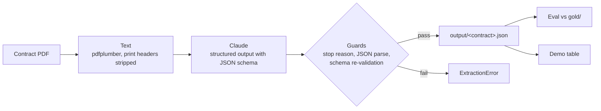

# Sponsorship Deliverables

An AI pipeline that turns sports sponsorship contracts into a trackable list of deliverables, with an eval that measures how accurate it is.

On the one contract with a hand-checked answer key, it found 12 of 14 deliverables (86% recall), produced no false ones (100% precision), got every contract term and payment date right, and every quote it returned appears word for word in the PDF.

## The problem

*This framing comes from my own research, not from interviews with partnership teams.*

Sports teams sell sponsors packages of deliverables: signage, LED and scoreboard messages, PA reads, broadcast spots, digital inventory, tickets, hospitality, player appearances. Over a season the partnership team has to deliver each one and prove it was delivered. That tracking usually starts with someone reading the contract and typing the obligations into a spreadsheet. A deliverable missed at that step tends to surface late, as a make-good owed to the sponsor or as friction at renewal time.

## What it does



The output has a `contract` block (sponsor, rights holder, seasons, term, territory, payments) and a list of `deliverables`. Here is one deliverable from the 2007 Mets / AlphaTrade contract, clause 4, as the model returned it ([full file](output/mets-alphatrade-2007.json)):

```json
{
  "section": "4",
  "category": "broadcast",
  "description": "Advertising inventory valued at $50,000 per season, based on the applicable rate card, during Mets and/or other programming on SportsNet New York.",
  "quantity": null,
  "unit": null,
  "frequency": "each season during the Term",
  "dollar_value": 50000,
  "details_to_be_agreed": true,
  "conditions": [
    "Value based on the applicable rate card",
    "Details to be mutually agreed between the parties"
  ],
  "sponsor_obligations": [],
  "proof_of_performance": null,
  "source_quote": "Advertising inventory with a value of $50,000, based on the applicable rate card, each season during the Term,\nduring Mets and/or other programming on SportsNet New York, with details to be mutually agreed to between the parties."
}
```

The deliverable is defined by value, not by count, so `quantity` is null and `dollar_value` carries it. The "mutually agreed" wording sets `details_to_be_agreed`, which flags it as something the team still has to schedule with the sponsor.

## How it works

**Structured outputs.** [`extract.py`](src/deliverables/extract.py) sends the contract text to Claude (`claude-sonnet-5-5` by default) with the schema from [`schema.py`](src/deliverables/schema.py) passed as `output_config.format` of type `json_schema`. The response text is then JSON matching the schema. Every field is required; fields a contract might not state are nullable, so the model has to answer each one, even if the answer is null.

**Guards.** Structured outputs only guarantee the schema on a normal finish, so the code checks before trusting the result:
- `stop_reason == "max_tokens"`: the JSON is probably cut off. Raise.
- `stop_reason == "refusal"`: the output may not match the schema. Raise.
- No text block, or text that isn't valid JSON. Raise.
- Re-validate with `jsonschema`. This should never fail, and it costs almost nothing to check.

Each failure raises `ExtractionError` with a specific message rather than writing a partial file.

**Extraction rules** (in the system prompt):
- One deliverable per numbered clause, unless a clause clearly contains separate items.
- Null when the contract doesn't state something. Never guess.
- Redacted payment amounts get `redacted: true` and `amount: null`.
- `source_quote` is copied verbatim from the contract.
- Legal boilerplate (indemnity, subordination, governing law, default interest) is not a deliverable.

## Evaluation

### Method

[`gold/mets-alphatrade-2007.json`](gold/mets-alphatrade-2007.json) is a hand-checked extraction of the Mets contract. [`evaluate.py`](src/deliverables/evaluate.py) scores a prediction against it:

- **Matching.** Deliverables pair only within the same clause, by `source_quote` similarity (1.0 if one quote contains the other, otherwise a `difflib` ratio), greedily, best first, one to one. Unmatched gold items count against recall; unmatched predictions count against precision.
- **Strict fields** on matched pairs: `category`, `quantity`, `dollar_value`, `details_to_be_agreed`, and whether `sponsor_obligations` and `conditions` are non-empty.
- **Contract block:** sponsor, rights holder, seasons, term dates, payment count, and each payment's due date and redacted flag.
- **Grounding:** the share of predicted quotes found verbatim in the PDF text.
- **Free text** (`description`, `unit`, `frequency`, condition and obligation wording) is not scored. Differences are listed in the eval output for a human to review.

### Results (Mets / AlphaTrade 2007, current run)

From [`output/eval/mets-alphatrade-2007.json`](output/eval/mets-alphatrade-2007.json):

| Measure | Result |
|---|---|
| Recall | 12 / 14 = 86% |
| Precision | 12 / 12 = 100% |
| `category` | 11 / 12 = 92% |
| `quantity` | 12 / 12 = 100% |
| `dollar_value` | 12 / 12 = 100% |
| `details_to_be_agreed` | 12 / 12 = 100% |
| has `sponsor_obligations` | 10 / 12 = 83% |
| has `conditions` | 12 / 12 = 100% |
| Contract block | 18 / 18 checks |
| Grounding | 12 / 12 quotes verbatim = 100% |

### Error patterns

The mismatches come from four patterns:

1. **Multi-part clauses merged into one.** Clause 5 grants three things: a sweepstakes, rotating banner ads on mets.com, and one promotional email. The gold file has three deliverables; the model returned one, with the banner ads and email folded into the description. Both missed deliverables (the whole recall gap) are from this clause, and the merged item was also miscategorized (`digital` instead of `activation`). For tracking, this matters: the banner ads and email each need their own proof of delivery.
2. **The per-season preamble missed in `frequency`.** The list of rights opens with "AlphaTrade will receive the following advertising and sponsorship rights during each of the 2007 and 2008 baseball seasons". The model often read only the clause itself: clause 5 got "during the Sweepstakes Period (approximately 6 to 8 weeks)", clause 9 "one mutually agreed date", clause 10 "each of five Spring Training home games". Gold has "once per season" (or "…, per season") for all three. A tracker built on these would schedule one softball game for the contract, not one per season. `frequency` is unscored free text, so the eval tables don't show this; it shows up only in the review list.
3. **An optional right recorded as an obligation.** Clause 6 lets the sponsor *buy* post-season seats. The model listed "Purchase post season tickets if desired" as a sponsor obligation.
4. **A mutual obligation handled one-sidedly.** Clause 12 requires a joint public announcement by both parties within three days of signing. The model recorded it as something the team delivers and left the sponsor's half out of `sponsor_obligations`. In the first run it also miscategorized the clause as `digital` (gold: `other`).

### How much to trust these numbers

This is one contract, 14 gold deliverables, and single runs. Results vary between runs: re-running the extraction fixed clause 12's category (category accuracy went from 10/12 to 11/12) and changed the wording of several `frequency` values, while recall and precision stayed the same. The numbers show where the pipeline breaks, not a stable accuracy figure.

## Other contracts (no gold file)

I ran two more public contracts through the pipeline. With no answer key, they were reviewed by reading the output against the PDF.

- **49ers / Violin Memory (2012 stadium sponsorship).** The model returned 38 deliverables, split at the sub-clause level (e.g. Schedule 1, 4(a)(i) through 4(a)(iv) for four separate TV shows). It showed two gaps in the schema:
  - **Redacted quantities look the same as unstated ones.** Many counts are redacted in the public filing ("a redacted number of :30 advertisements"). The model correctly set `quantity: null` and said so in the description, but in the structured data that null can't be told apart from "the contract gives no number", and those mean different things to a tracker.
  - **Seasons defined relative to the stadium opening don't fit a list of years.** The term runs ten Contract Years starting the year the stadium opens (anticipated 2014). `seasons` expects a list like `["2007", "2008"]`, so the model returned one descriptive string instead.
- **Learfield / Vanderbilt (2026).** The benefits are defined in Exhibit A, which is blank in the public filing (the heading is there with no content). The model didn't make up deliverables to fill the gap. It returned four general ones from the body text (benefits per Exhibit A, a marks license, ad placement space, make-good benefits), noted that Exhibit A's contents were not in the text, and extracted all 39 payment installments.

## Design decisions

- **Structured outputs over forced tool use.** Forcing a tool call with `tool_choice` returns a 400 on `claude-sonnet-5-5`. Structured outputs is the native way to get a JSON-only response matching a schema, without wrapping the data in a fake tool.
- **Null over guessing.** A wrong number in a tracker is worse than a blank one, because a blank gets a human to look. The schema makes every field required but nullable, and the prompt says to use null when the contract is silent.
- **A verbatim `source_quote` on every deliverable.** A reviewer can check any row against the contract in seconds, and the eval can check grounding mechanically. A quote that isn't in the PDF is a red flag.
- **A small, explainable eval rather than an LLM judge, for v1.** Every number traces back to a specific pair of values. That made the error patterns above easy to find. The cost is that free-text fields go unscored.

## Limitations and next steps

- **Fix clause merging and preamble handling in the prompt**, then re-run the eval to confirm recall and the frequency values improve without breaking anything else.
- **Schema additions:** a `redacted` flag on deliverables (as payments already have), and a `make_good_terms` field, since contracts like Vanderbilt's define what happens when a benefit can't be delivered.
- **An LLM-as-judge for free-text fields** like `frequency`, where errors that matter for tracking currently go unscored.
- **Multiple runs per contract** to measure variance instead of reporting a single run.
- **More gold files**, starting with a 49ers subset.
- **Where this is heading:** reconcile the extracted deliverables against proof-of-performance data (broadcast logs, signage photos, ticket scans), then draft end-of-season recaps for each partner.

## How it was built

I planned and reviewed; Claude Code implemented. Each step started as a written task brief ([docs/prompts/](docs/prompts/)) with scope, test cases, and acceptance criteria. Claude Code built and staged the change, and I reviewed every diff before committing. [`CLAUDE.md`](CLAUDE.md) holds the project rules the agent follows: tests stay offline, never call the real API in tests, don't change the schema without asking.

Tests were the guardrail: the API client is faked, so all 33 tests run offline and every change had to keep them green. The briefs also show where plans changed. Task 1 asked for forced tool use, the API rejected it on `claude-sonnet-5-5`, and the follow-up switched to structured outputs.

## Run it

Needs Python 3.11+ and an Anthropic API key.

```bash
python3 -m venv .venv && source .venv/bin/activate
pip install -e ".[dev]"
cp .env.example .env              # set ANTHROPIC_API_KEY; ANTHROPIC_MODEL is optional

# extract (calls the API, writes output/<contract>.json)
python -m deliverables.cli data/contracts/mets-alphatrade-2007.pdf
python -m deliverables.cli --all

# evaluate against gold (offline, writes output/eval/<contract>.json)
python -m deliverables.eval_cli mets-alphatrade-2007
python -m deliverables.eval_cli --all

# demo page, two tabs at the top:
#   Upload a contract (first tab): upload any PDF, "Extract deliverables" calls the API;
#     shows the table, grounding, and a JSON download; nothing is saved to output/
#   Try a sample contract: saved output for the bundled PDFs; only "Re-run extraction" calls the API
#   Select a table row to see the contract text, conditions and sponsor obligations behind it
pip install -e ".[demo]"
streamlit run app.py

# tests (offline, the API client is faked)
pytest
```

## Repo layout

```
app.py                     Streamlit demo page (upload tab + sample tab)
.streamlit/config.toml     demo theme (colors, Barlow fonts)
src/deliverables/
  schema.py                JSON schema for the extraction
  pdf_text.py              PDF to text
  extract.py               Claude call, guards, validation
  cli.py                   extraction CLI
  evaluate.py              scoring against gold (pure)
  eval_cli.py              eval CLI and report
  table.py                 JSON to table rows, plus display headers and labels for the demo
  ui.py                    Streamlit rendering for the demo (contract summary, table, row detail)
data/contracts/            input PDFs (public filings)
gold/                      hand-checked extractions
output/                    extraction results; output/eval/ has eval results
tests/                     offline pytest suite
```
